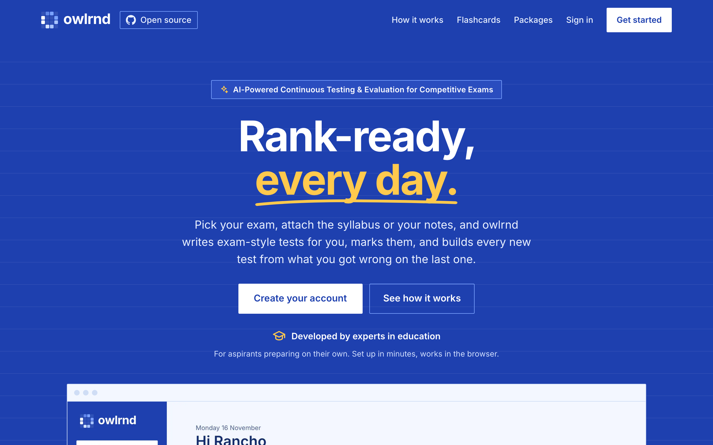
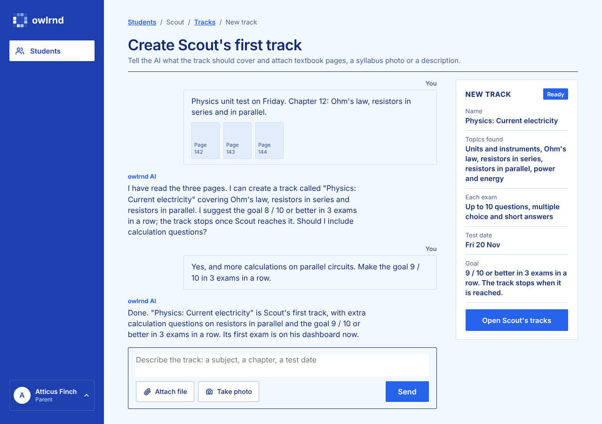
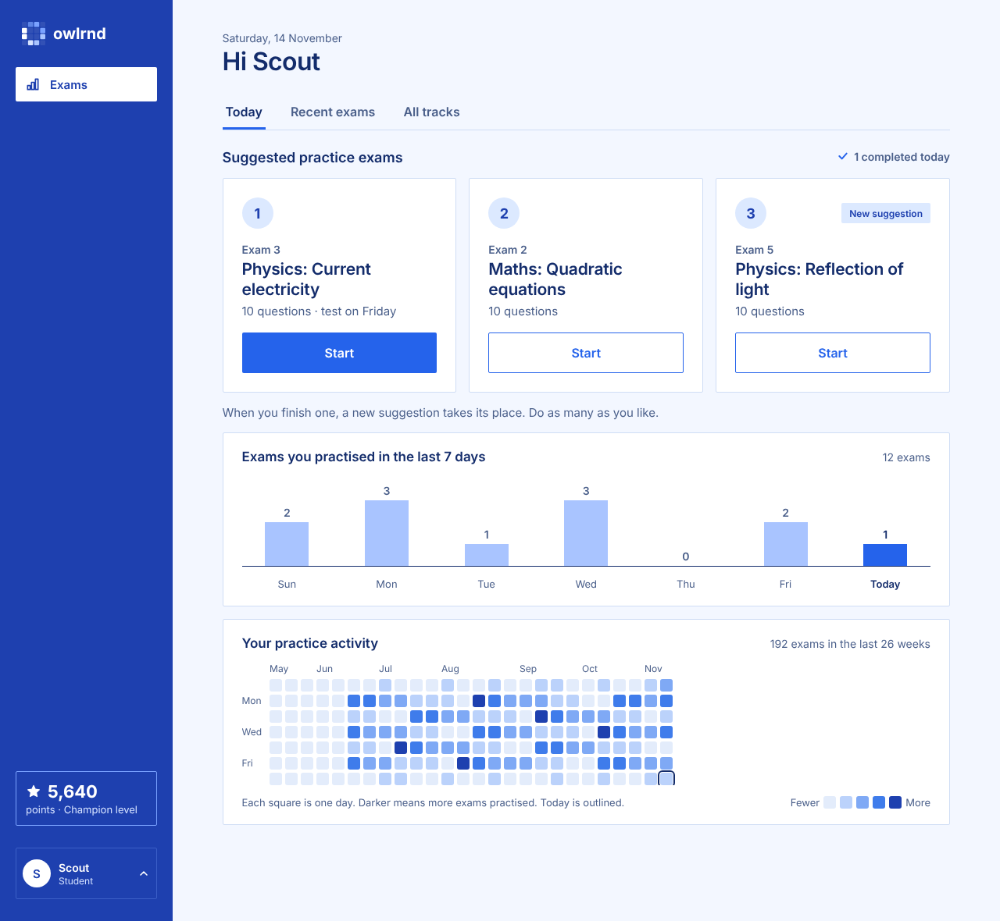
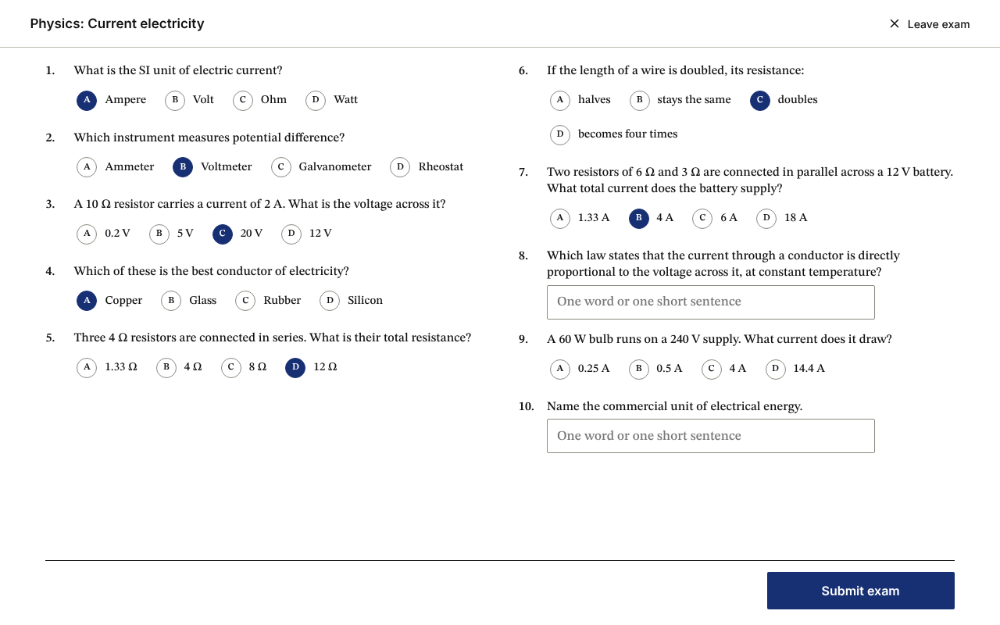
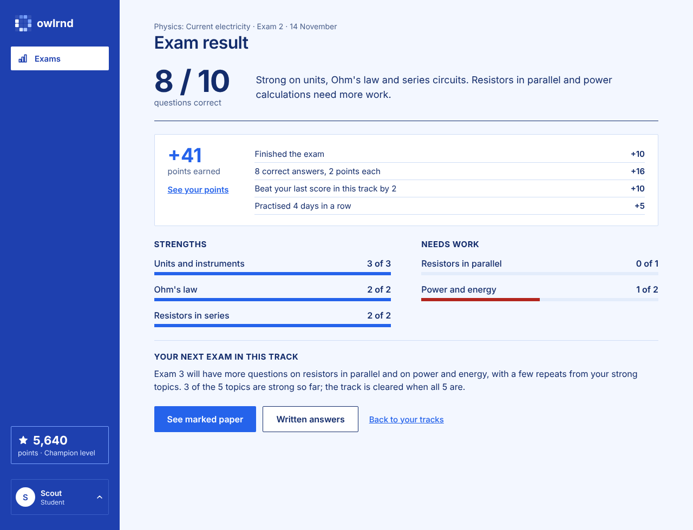
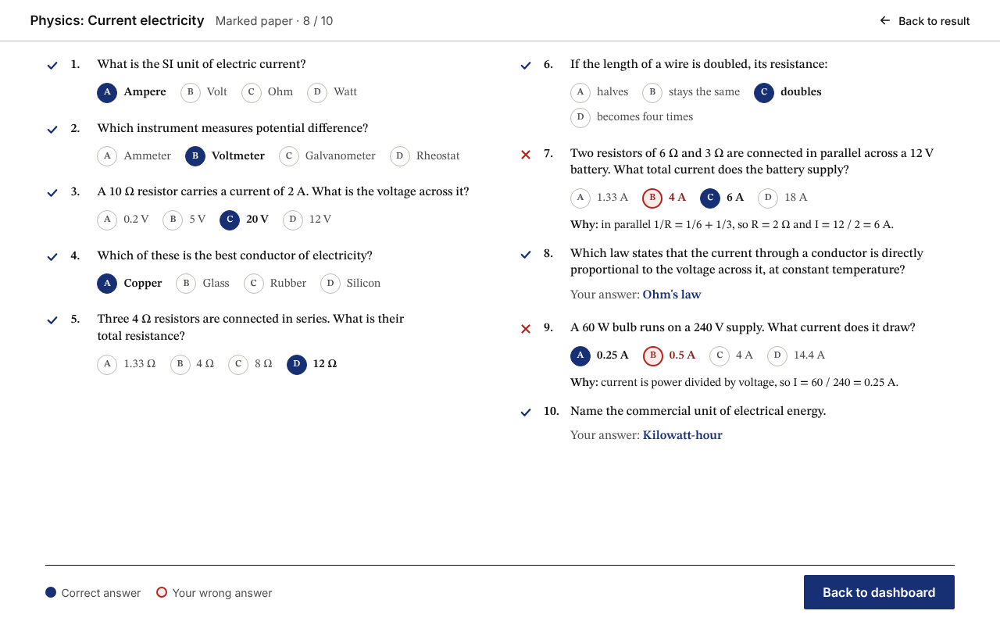
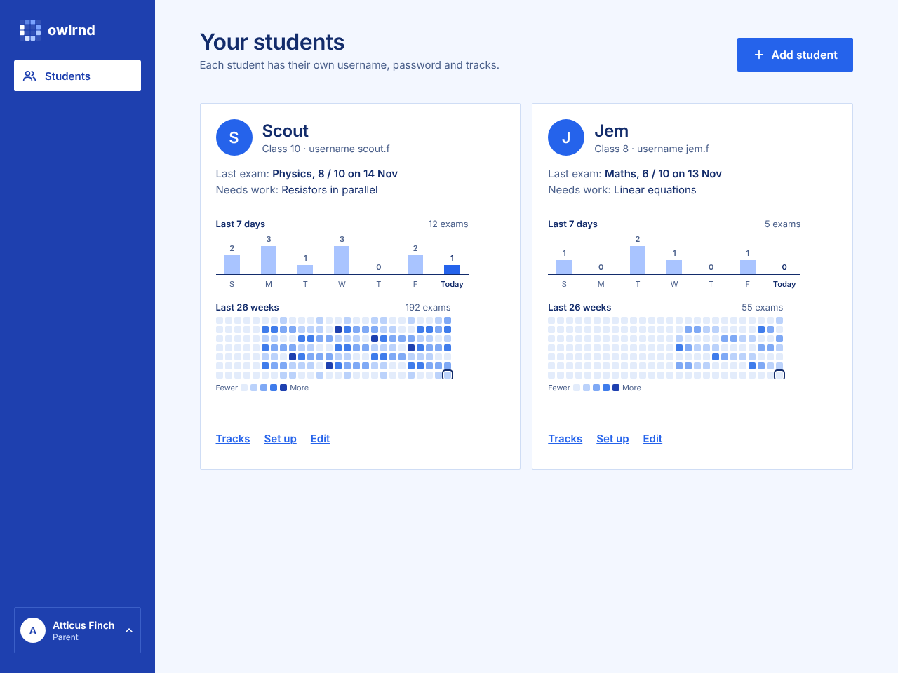

# owlrnd

Short, paper-style practice exams that adapt between exams. A parent sets up practice tracks for each child; the child practises.

- **Brief and rules:** [`CLAUDE.md`](CLAUDE.md), [`docs/`](docs/) (`05-rules.md` is the source of truth), [`screens/`](screens/), [`mockups/`](mockups/)
- **Build plan and progress:** [`PLAN.md`](PLAN.md)

## Screenshots



<table>
  <tr>
    <td width="50%"></td>
    <td width="50%"></td>
  </tr>
  <tr>
    <td><b>1. The parent sets up a track.</b> Describe the chapter or test, attach photos of the textbook pages, and agree the topics and a goal with the AI.</td>
    <td><b>2. The child sees what to do today.</b> Three suggested exams, and a record of practice over the week.</td>
  </tr>
  <tr>
    <td></td>
    <td></td>
  </tr>
  <tr>
    <td><b>3. A short paper that fits the screen.</b> Up to 10 questions, laid out like a printed exam, with no scrolling.</td>
    <td><b>4. The result shapes the next exam.</b> Score, points, strengths, what needs work, and what the next paper will focus on.</td>
  </tr>
  <tr>
    <td></td>
    <td></td>
  </tr>
  <tr>
    <td><b>5. Every miss is explained.</b> The marked paper shows the right answer and a one-line reason.</td>
    <td><b>6. The parent sees effort and weak spots.</b> One page for all their children.</td>
  </tr>
</table>

These are the design screens (sample family: Atticus Finch, Scout and Jem). All 41 screens are in [`screens/`](screens/), listed with what each one does in [`docs/04-screens.md`](docs/04-screens.md).

## Run it locally

Needs Node 20+ and Docker.

```bash
npm install
cp .env.example .env.local      # then set AUTH_SECRET (command in the file)
npm run db:up                   # Postgres 16 (port 5433) and Mailpit in Docker
npm run db:migrate
npm run dev                     # http://localhost:3000
```

Every code email (verify, sign-in, password reset) goes to **Mailpit** in development: open the inbox at http://localhost:8025. Tests read codes from Mailpit's API (`tests/mailpit.ts`).
Other transports: `EMAIL_TRANSPORT=postmark` with `POSTMARK_SERVER_TOKEN` and `EMAIL_FROM` sends real email; `EMAIL_TRANSPORT=console` just prints codes in the server log.

The AI features (from M3) need `ANTHROPIC_API_KEY` in `.env.local`. Without a key, set `OWLRND_FAKE_AI=1` to use the built-in fake AI (what the automated tests use). `npm run ai:smoke` runs a live check of the real Claude calls with a sample textbook page.

## Scripts

| Command | What it does |
|---|---|
| `npm run dev` | Dev server; also starts the background job worker |
| `npm test` | Unit tests for the rules, plus integration tests against the dev database |
| `npm run test:e2e` | Playwright browser tests against a production build (first time: `npx playwright install chromium`; `PW_DEV=1` uses the dev server) |
| `npm run typecheck` / `npm run lint` | TypeScript and ESLint |
| `npm run db:generate -- --name <name>` | Create a migration after changing `src/server/db/schema.ts` |
| `npm run db:migrate` | Apply migrations |
| `npm run db:up` / `npm run db:down` | Start or stop Postgres and Mailpit |

## Layout

```
src/config/rules.ts   every default from docs/10-decisions.md, in one place
src/domain/           business rules as pure, unit-tested functions
src/server/           db (Drizzle), email (Mailpit/SMTP, Postmark, console), files, jobs (Postgres queue), ai (Claude)
src/components/       app shell, sidebar, profile menu, …
src/app/              routes
tests/e2e/            Playwright
```

## Accounts (M1)

- One sign-in (`/sign-in`) for parents and students; every sign-in is confirmed with a 6-digit code emailed to the parent. In dev, read it in Mailpit.
- Parents sign up at `/sign-up`. Students are added by their parent (M2); until then, tests create them directly.
- Code, session and password rules live in `src/domain/codes.ts`, `src/domain/identity.ts` and `src/config/rules.ts`; the server side is in `src/server/auth/`.

## Screenshots for review

Screenshots taken while building each milestone are kept in `tmp/screenshots/<milestone>/` (git-ignored), named by screen code, for example `tmp/screenshots/m4/4.1b-paper-1280-page1.png`.

In development, `/dev/shell?role=student` and `/dev/shell?role=parent` preview the signed-in layout with sample data.

## Running costs: plan an AI budget

owlrnd uses the Claude API to read textbook pages, agree tracks with the parent, write each exam and mark typed answers. You pay Anthropic for that by usage, so set a monthly spend limit on your API key in the [Claude Console](https://console.anthropic.com) before you invite families.

The figures below are **estimates** from the app's prompt sizes and recorded outputs, at Claude Opus 5.5 list prices of November 2026 ($4 per million input tokens, $20 per million output tokens). They are not measurements; check current prices on Anthropic's pricing page.

### Per exam

| Step | Tokens (approx.) | Cost |
|---|---|---|
| Writing the paper (effort `high`) | In: ~5,000 (instructions, topics, text read from the textbook pages, recent questions to avoid). Out: ~1,000 of questions plus ~3,000–8,000 of reasoning | $0.10–0.20 |
| Marking typed answers (effort `medium`) | In: ~1,500. Out: ~1,000–1,500 | $0–0.03 |
| **Per exam** | | **~$0.12–0.23** |

Multiple-choice answers, blank answers and answers that exactly match the expected answer are marked by owlrnd itself, with no AI call. A paper that fails validation is rewritten once, which adds about 5–10% overall.

### Per child per month

One child taking 3 exams a day for 30 days (90 exams), with about 4 new chapters set up in the month:

| | Cost |
|---|---|
| 90 exams | $11–21 |
| Setting up tracks (chat turns with textbook photos, ~$0.05–0.10 each) | $1–2 |
| Rewritten papers | ~$1 |
| **Total** | **~$12–25 per child per month** |

Scale this by the number of active children and how often they practise. A child doing one exam a day costs roughly a third of this.

### Bringing the cost down

The largest share is the model's reasoning while writing each paper, because output tokens cost five times as much as input.

| Change | Where | Approx. per child per month | Trade-off |
|---|---|---|---|
| Write papers at effort `medium` | `effort` in `src/server/ai/writeQuestions.ts` | $8–15 | Possibly slightly weaker questions |
| Use Claude Sonnet 5.5 ($2 / $10 per million tokens) | `ANTHROPIC_MODEL=claude-sonnet-5-5` | $6–12 | Test sample papers against Opus first |
| Use Claude Haiku 5.5 ($0.10 / $0.50) | `ANTHROPIC_MODEL=claude-haiku-5-5` | under $1 | Real risk of weaker questions or wrong answer keys |

Whatever you choose, check a batch of real papers and marked answers before relying on it: a wrong answer key teaches a child the wrong thing.

### Built-in limits

owlrnd records the cost of every Claude call and enforces limits so a bill can't run away:

- **Monthly budget:** `AI_MONTHLY_BUDGET_USD` (default $150). The address in `OWNER_EMAIL` gets an email at 80% and at 100%. At 100%, new track chats and new exams pause until the next month or until you raise the budget; exams already submitted are still marked.
- **Per family per day:** 40 track-chat messages and 20 exams written (`aiLimits` in `src/config/rules.ts`). Over the exam limit, the next exam is written after the family's midnight.
- **See the spend:** `npm run ai:usage` shows this month's total, the cost per kind of call, and the families using the most.

Also set a spend limit on the API key itself in the Claude Console, as a last safety net.

### Hosting

Hosting is separate from the AI cost. The reference setup (one 2 GB server for the app and background worker, managed PostgreSQL, private object storage for photos, and an email service for sign-in codes) costs about **$30 a month** on AWS Lightsail, S3 and SES, for a small group of families.

## Licence

owlrnd is free software: you can redistribute it and/or modify it under the terms of the **GNU Affero General Public License** as published by the Free Software Foundation, either version 3 of the License, or (at your option) any later version. See [`LICENSE`](LICENSE).

Copyright (C) 2026 Unni Koroth.

In short: you may use, study, change and share owlrnd. If you run a modified version as a service that other people use over a network, you must offer those users the source code of your version under the same licence (section 13). The licence comes with no warranty.

Third-party parts keep their own licences: npm dependencies (MIT, Apache-2.0, ISC, BSD, LGPL-3.0 for `libvips` in `sharp`), and the Inter and STIX Two Text fonts (SIL Open Font License).
