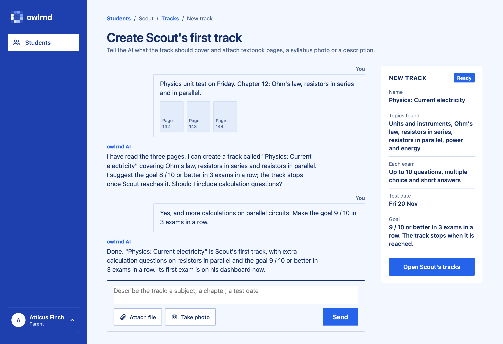
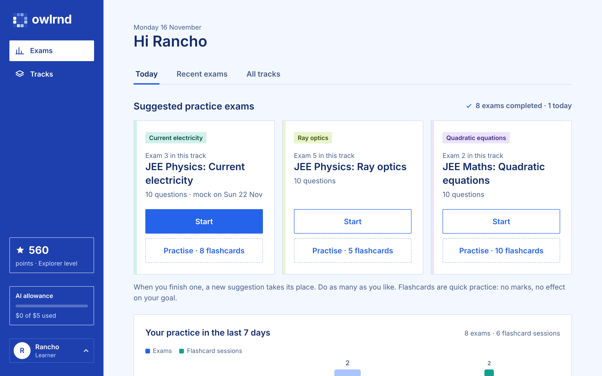
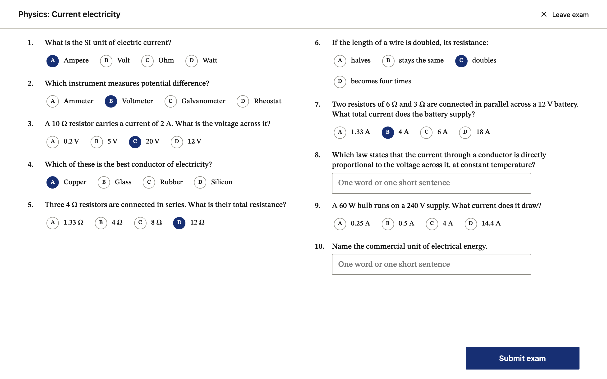
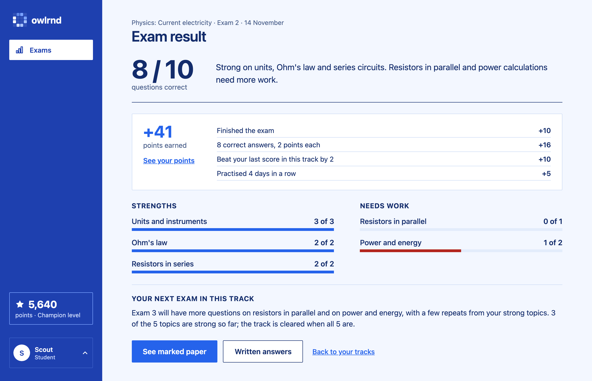
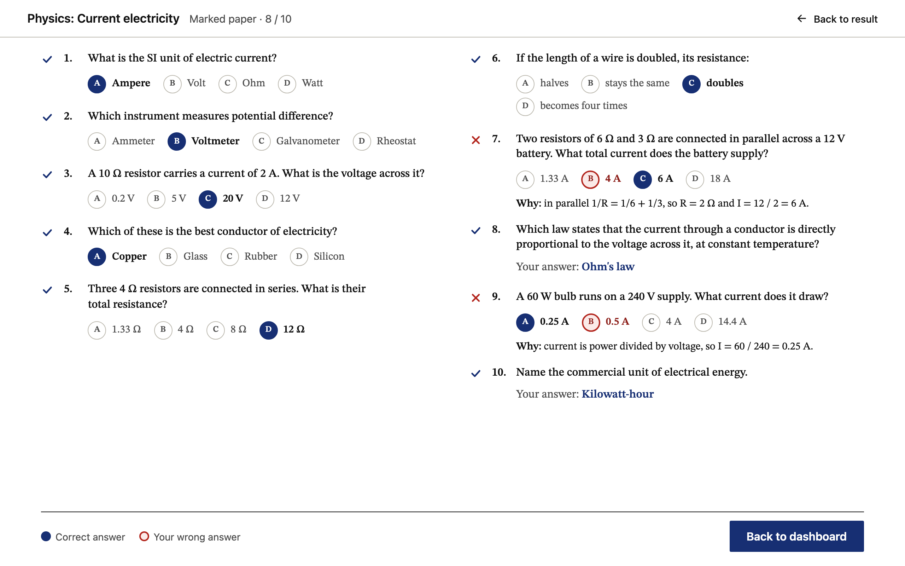
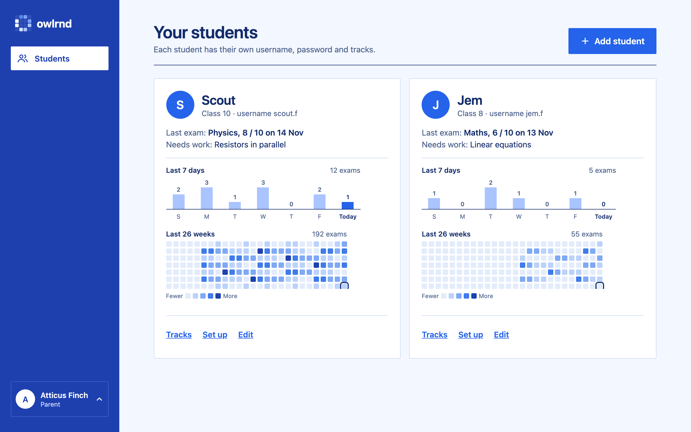
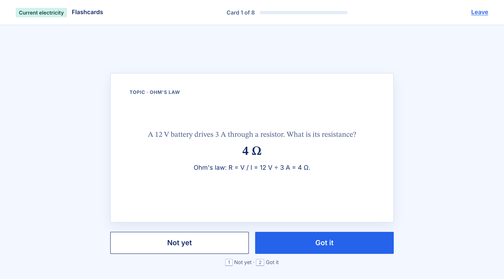
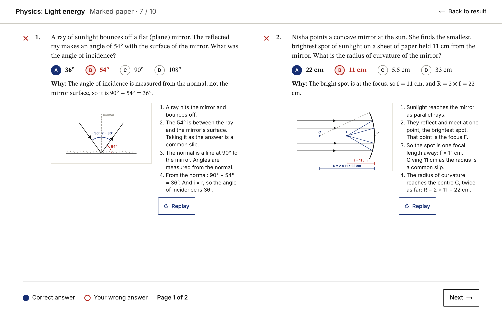

# owlrnd

Short, paper-style practice exams that adapt between exams, with flashcards in between. Learners preparing for an exam set up their own practice tracks; parents can set them up for school-age children, who just practise.

- **Brief and rules:** [`CLAUDE.md`](CLAUDE.md), [`docs/`](docs/) (`05-rules.md` is the source of truth), [`screens/`](screens/), [`mockups/`](mockups/)
- **Build plan and progress:** [`PLAN.md`](PLAN.md)

## Screenshots


<table>
  <tr>
    <td width="50%"></td>
    <td width="50%"></td>
  </tr>
  <tr>
    <td><b>1. The parent sets up a track.</b> Describe the chapter or test, attach photos of the textbook pages, and agree the topics and a goal with the AI.</td>
    <td><b>2. The learner sees what to do today.</b> Three suggested exams, flashcards to practise for each track, and a record of practice over the week.</td>
  </tr>
  <tr>
    <td></td>
    <td></td>
  </tr>
  <tr>
    <td><b>3. A short paper that fits the screen.</b> Up to 10 questions, laid out like a printed exam, with no scrolling.</td>
    <td><b>4. The result shapes the next exam.</b> Score, points, strengths, what needs work, and what the next paper will focus on.</td>
  </tr>
  <tr>
    <td></td>
    <td></td>
  </tr>
  <tr>
    <td><b>5. Every miss is explained.</b> The marked paper shows the right answer and a one-line reason.</td>
    <td><b>6. The parent sees effort and weak spots.</b> One page for all their children.</td>
  </tr>
  <tr>
    <td></td>
    <td></td>
  </tr>
  <tr>
    <td><b>7. Flashcards between exams (0.3).</b> Short cards from the track's material and missed questions. Say Got it or Not yet; cards come back on a spaced schedule. No marks, no effect on the goal.</td>
    <td><b>8. A picture for the miss (0.3.15).</b> Where a diagram helps, a wrong answer shows a short animated picture in a few captioned steps: the common slip in red, the right idea in navy. Flashcards show them on the answer side. Names and definitions get none.</td>
  </tr>
</table>

Most are the design screens (sample family: Atticus Finch, Scout and Jem); 2, 7 and 8 are taken from the app. All 41 screens are in [`screens/`](screens/), listed with what each one does in [`docs/04-screens.md`](docs/04-screens.md).

## What's coming

**Released so far:** 0.1, the core loop (a parent sets up tracks, the child practises short adaptive exams, both see progress); 0.2, two kinds of account (learners preparing on their own, with a parent's consent from 13 to 17, and parent-managed children), a demo AI allowance per account and goals that need every topic strong; 0.3 "Flashcards" ([`docs/plan-0.3-flashcards.md`](docs/plan-0.3-flashcards.md)); 0.3.15, pictures for wrong answers and flashcards ([`docs/plan-wrong-answer-visuals.md`](docs/plan-wrong-answer-visuals.md)).

Here's what's planned next, roughly in order. The full roadmap is in [`docs/09-roadmap.md`](docs/09-roadmap.md).

**Soon after the first release**

- Exams in full screen
- Photograph textbook pages from inside the chat
- Safer email changes

**Next versions**

- A separate tracker for flashcard practice
- Written answers on paper
- Camera capture (0.2)
- Ready-made packages (CBSE, ICSE)
- A whole term at once
- Create a track from Claude
- Progress views

Have an idea or want to help build one of these? Open an issue or a pull request.

## Run it locally

Needs Node 20+ and Docker.

```bash
npm install
cp .env.example .env.local      # then set AUTH_SECRET (command in the file)
npm run db:up                   # Postgres 16 (port 5433) and Mailpit in Docker
npm run db:migrate
npm run dev                     # http://localhost:3000
```

Every code email (verify, sign-in, password reset) goes to **Mailpit** in development: open the inbox at http://localhost:8025. Tests read codes from Mailpit's API (`tests/mailpit.ts`).
Other transports: `EMAIL_TRANSPORT=postmark` with `POSTMARK_SERVER_TOKEN` and `EMAIL_FROM` sends real email; `EMAIL_TRANSPORT=console` just prints codes in the server log.

The AI features (from M3) need `ANTHROPIC_API_KEY` in `.env.local`. Without a key, set `OWLRND_FAKE_AI=1` to use the built-in fake AI (what the automated tests use). `npm run ai:smoke` runs a live check of the real Claude calls with a sample textbook page.

## Scripts

| Command | What it does |
|---|---|
| `npm run dev` | Dev server; also starts the background job worker |
| `npm test` | Unit tests for the rules, plus integration tests against the dev database |
| `npm run test:e2e` | Playwright browser tests against a production build (first time: `npx playwright install chromium`; `PW_DEV=1` uses the dev server) |
| `npm run typecheck` / `npm run lint` | TypeScript and ESLint |
| `npm run db:generate -- --name <name>` | Create a migration after changing `src/server/db/schema.ts` |
| `npm run db:migrate` | Apply migrations |
| `npm run db:up` / `npm run db:down` | Start or stop Postgres and Mailpit |

## Layout

```
src/config/rules.ts   every default from docs/10-decisions.md, in one place
src/domain/           business rules as pure, unit-tested functions
src/server/           db (Drizzle), email (Mailpit/SMTP, Postmark, console), files, jobs (Postgres queue), ai (Claude)
src/components/       app shell, sidebar, profile menu, …
src/app/              routes
tests/e2e/            Playwright
```

## Flashcards (0.3)

- **Writing cards:** the background job `write_flashcards` (`src/server/flashcards.ts`, AI in `src/server/ai/writeFlashcards.ts`) writes a starter deck when a track is created or gets new topics (about 6 cards per topic, up to 60), up to 3 cards from missed questions after each marked exam, and top-ups of 10. A deck stops at 200 cards. Exams and cards rarely repeat each other's wording.
- **Practising:** `/practise/[trackId]` (focus mode, no sidebar; Space, then 1 / 2) and the deck page `/tracks/[trackId]/flashcards`. Practise buttons with due counts are on the dashboard and on Your tracks.
- **Rules:** Leitner boxes (due again after 1, 2, 4, 8 or 16 days), 5 points per finished session of 8+ cards (at most 2 a day per track), no effect on scores, goals or streaks. All in `rules.flashcards` (`src/config/rules.ts`) and `src/domain/flashcards.ts`; rules §8 and §9a.

## Pictures (0.3.15)

- **Drawing:** after a paper, a pool batch or cards are written, the background job `draw_visuals` (`src/server/visuals.ts`, AI in `src/server/ai/drawVisuals.ts`) sends up to 10 of them to Claude, which describes a picture for each one a picture helps, or none. Writing never waits for it. A card made from a missed question takes that question's picture.
- **Scene format and checks:** `src/domain/visualScene.ts`: named points, rays by angle and length, angle arcs in degrees, labels, up to 5 captioned steps and simple moves, turns and fades. Every scene is checked (frame, known points, limits, fixed colours) and asked for once more if it fails, then dropped. Drawn by `src/components/visuals/` (plain SVG, no library).
- **Where:** under a wrong answer on the marked paper, playing when its page comes up (the paging includes it, so the page never scrolls), and on a card's answer side. Reduced motion shows the finished picture.
- **Trying it:** `/dev/visuals` shows the nine sample scenes (`src/content/visuals/samples.ts`); `npm run ai:visuals -- items.json` draws pictures for your own questions with the live API and prints the cost. Settings in `rules.visuals`; AI behaviour in `docs/07-ai.md` §8.

## Accounts (M1)

- One sign-in (`/sign-in`) for parents and students; every sign-in is confirmed with a 6-digit code emailed to the parent. In dev, read it in Mailpit.
- Parents sign up at `/sign-up`. Students are added by their parent (M2); until then, tests create them directly.
- Code, session and password rules live in `src/domain/codes.ts`, `src/domain/identity.ts` and `src/config/rules.ts`; the server side is in `src/server/auth/`.

## Screenshots for review

Screenshots taken while building each milestone are kept in `tmp/screenshots/<milestone>/` (git-ignored), named by screen code, for example `tmp/screenshots/m4/4.1b-paper-1280-page1.png`.

In development, `/dev/shell?role=student` and `/dev/shell?role=parent` preview the signed-in layout with sample data.

## Running costs: plan an AI budget

owlrnd uses the Claude API to read textbook pages, agree tracks with the parent, write each exam, mark typed answers, write flashcards and draw pictures for them. You pay Anthropic for that by usage, so set a monthly spend limit on your API key in the [Claude Console](https://console.anthropic.com) before you invite families.

The figures below are **estimates** from the app's prompt sizes and recorded outputs, for **Claude Opus 5.5** (model ID `claude-opus-5-5`, the app's default `ANTHROPIC_MODEL`) at its list prices of November 2026 ($4 per million input tokens, $20 per million output tokens), checked against one real test track in November 2026 (see *Measured* below). Check current prices on Anthropic's pricing page.

### Per exam

| Step | Tokens (approx.) | Cost |
|---|---|---|
| Writing the paper (effort `high`) | In: ~5,000 (instructions, topics, text read from the textbook pages, recent questions to avoid). Out: ~1,000 of questions plus ~3,000–8,000 of reasoning | $0.10–0.20 |
| Marking typed answers (effort `medium`) | In: ~1,500. Out: ~1,000–1,500 | $0–0.03 |
| Flashcards from missed questions (up to 3 cards, after marking) *(0.3)* | In: ~5,000. Out: ~600–1,000 | $0.03 |
| The deck's card fronts in the paper's prompt, so exams rarely repeat them *(0.3)* | In: up to ~3,000 more | $0–0.01 |
| Pictures for the paper's new questions, drawn in the background *(0.3.15)* | In: ~4,300. Out: ~12,500 per 10 questions | ~$0.27 (measured) |
| **Per exam** | | **~$0.40–0.55** (~$0.13–0.27 without pictures) |

Multiple-choice answers, blank answers and answers that exactly match the expected answer are marked by owlrnd itself, with no AI call. A paper that fails validation is rewritten once, which adds about 5–10% overall.

### Flashcards *(0.3)*

Practising flashcards makes **no AI calls**; only writing cards does.

| Step | Tokens | Cost |
|---|---|---|
| Starter deck when a track is created: about 6 cards per topic, up to 60 | In: ~4,700. Out: ~9,300 for 60 cards | ~$0.20 (measured, 60 cards) |
| Top-up of 10 cards, when a learner practises with none due | In: ~5,100. Out: ~1,100–1,900 | $0.04–0.06 (measured) |
| **Most a track can ever cost in cards** (a deck stops at 200) | | **~$0.70–1.15** |

### Pictures *(0.3.15)*

Measured on 28 November 2026 with 10 real optics questions on `claude-opus-5-5` at effort `medium`: 7 got a picture, 3 correctly got none, in one call of 4,290 input and 12,471 output tokens, **$0.27** and 106 s. Effort `low` cost $0.17 but the pictures were visibly worse, so the app uses `medium` (`rules.visuals.effort`). Pictures for a 60-card starter deck add about $1.60. Subjects with fewer diagrams (vocabulary, history) get fewer pictures and cost less. Questions and cards written before 0.3.15 are drawn only when an exam or practice session picks them. With pictures, the $5 demo allowance covers roughly half as many exams as the figures below; set `rules.visuals.enabled` to `false` to turn pictures off.

### Measured (one test track, 16 November 2026, `claude-opus-5-5`)

Every call used Claude Opus 5.5 (`claude-opus-5-5`). A parent set up a 10-topic Physics track in two chat turns ($0.16 and $0.04), the first exam was written for $0.09, the starter deck of 60 cards for $0.21, and two top-ups of 10 cards for $0.04 and $0.06: **$0.60 in all** before any exam was marked. The first chat turn costs the most, because it carries the instructions and the parent's material.

### Per child per month

One child taking 3 exams a day for 30 days (90 exams), with about 4 new chapters set up in the month:

| | Cost |
|---|---|
| 90 exams, including their missed-question cards | $12–24 |
| Setting up 4 tracks (2–3 chat turns each, ~$0.20–0.35 a track) | $1–1.5 |
| Starter decks for 4 tracks | ~$0.80 |
| Flashcard top-ups (a few a week) | $0.50–2 |
| Rewritten papers | ~$1 |
| **Total** | **~$15–29 per child per month** |

Scale this by the number of active children and how often they practise. A child doing one exam a day costs roughly a third of this. Flashcards add about $2–4 of this; practising them is free.

**The $5 demo allowance per account** (`rules.aiLimits.perAccountUsd`) covers setting up a track or two and roughly **15–35 exams**, with all the flashcard practice the learner wants on top.

### Measured on the live site (18 November 2026)

From 40 Claude calls on owlrnd.com (3 tracks, 12 marked exams, Claude Opus 5.5), leaving out one Hindi track whose flashcards failed and were retried because of a bug fixed in 0.3.4:

| Per month, one active learner (90 exams, 4 tracks) | Estimate above | Measured |
|---|---|---|
| Writing exam papers | $14.50 | $11.40 |
| Marking typed answers | $1.35 | $0.90 |
| Flashcards from missed questions, plus top-ups | $3.95 | $7.00 |
| Starter flashcard decks | $0.80 | $0.84 |
| Set-up chat | $1.25 | $1.12 |
| **Total** | **$21.85** | **$21.26** |

That is about **$0.22 per exam** all in, so the $5 demo allowance covers about **20 exams**. The **Solar System sample track** uses no AI to write its exams or cards (only the rare typed answer that isn't an exact match is marked by the AI).

**Question pool (0.3.5).** Writing questions in batches costs about the same per question as writing one paper at a time (measured: $0.120 for 20 questions against $0.063 for 10), so it doesn't change these totals; it makes exams ready at once and lets them carry on while the allowance is used up. Check it on your own key with `npm run ai:measure-pool` (a few tens of cents).

### Bringing the cost down

The largest share is the model's reasoning while writing each paper, because output tokens cost five times as much as input.

| Change | Where | Approx. per child per month | Trade-off |
|---|---|---|---|
| Write papers at effort `medium` | `effort` in `src/server/ai/writeQuestions.ts` | $8–15 | Possibly slightly weaker questions |
| Use Claude Sonnet 5.5 ($2 / $10 per million tokens) | `ANTHROPIC_MODEL=claude-sonnet-5-5` | $6–12 | Test sample papers against Opus first |
| Use Claude Haiku 5.5 ($0.10 / $0.50) | `ANTHROPIC_MODEL=claude-haiku-5-5` | under $1 | Real risk of weaker questions or wrong answer keys |

Whatever you choose, check a batch of real papers and marked answers before relying on it: a wrong answer key teaches a child the wrong thing.

### Built-in limits

owlrnd records the cost of every Claude call and enforces limits so a bill can't run away:

- **Monthly budget:** `AI_MONTHLY_BUDGET_USD` (default $150). The address in `OWNER_EMAIL` gets an email at 80% and at 100%. At 100%, new track chats and new exams pause until the next month or until you raise the budget; exams already submitted are still marked.
- **Per family per day:** 40 track-chat messages and 20 exams written (`aiLimits` in `src/config/rules.ts`). Over the exam limit, the next exam is written after the family's midnight.
- **See the spend:** `npm run ai:usage` shows this month's total, the cost per kind of call, and the families using the most.

Also set a spend limit on the API key itself in the Claude Console, as a last safety net.

### Hosting

Hosting is separate from the AI cost. The reference setup (one 2 GB server for the app and background worker, managed PostgreSQL, private object storage for photos, and an email service for sign-in codes) costs about **$30 a month** on AWS Lightsail, S3 and SES, for a small group of families.

## Licence

owlrnd is free software: you can redistribute it and/or modify it under the terms of the **GNU Affero General Public License** as published by the Free Software Foundation, either version 3 of the License, or (at your option) any later version. See [`LICENSE`](LICENSE).

Copyright (C) 2026 Unni Koroth.

In short: you may use, study, change and share owlrnd. If you run a modified version as a service that other people use over a network, you must offer those users the source code of your version under the same licence (section 13). The licence comes with no warranty.

Third-party parts keep their own licences: npm dependencies (MIT, Apache-2.0, ISC, BSD, LGPL-3.0 for `libvips` in `sharp`), and the Inter and STIX Two Text fonts (SIL Open Font License).
